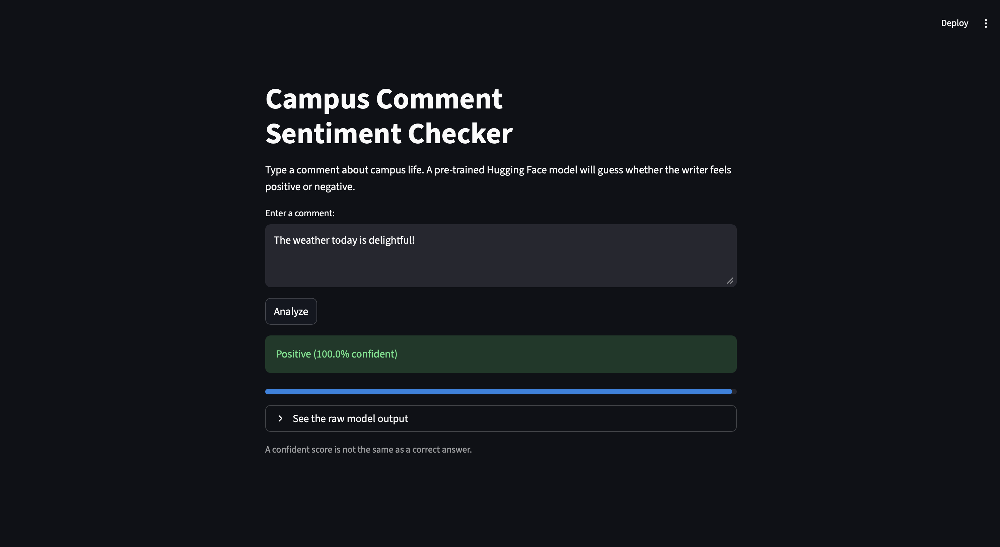

# Intro to Hugging Face

An in-class introduction to the Hugging Face ecosystem and transformer models.
This project uses a pre-trained sentiment-analysis model to demonstrate the
Hugging Face Hub, pipelines, tokenization, and a small Streamlit application.

## Model

The notebook and app use
[`distilbert-base-uncased-finetuned-sst-2-english`](https://huggingface.co/distilbert-base-uncased-finetuned-sst-2-english)
through the Transformers `pipeline` API.

The model returns:

```python
[{"label": "POSITIVE", "score": 0.999}]
```

The `score` is the model's confidence in its selected label. It is not a
guarantee that the prediction is correct. This model has only two output
labels, so it must classify neutral statements as either positive or negative.
It may also struggle with sarcasm, context, unfamiliar phrasing, and potential
bias in its training data.

## Requirements

- Python 3.10 or newer
- `pip`
- A few hundred megabytes of disk space for the downloaded model

Install the project dependencies from a terminal:

```bash
pip install streamlit transformers torch
```

For the notebook's optional Hugging Face account and environment-variable
sections, also install:

```bash
pip install python-dotenv huggingface-hub
```

## Run the Streamlit app

From the project directory:

```bash
streamlit run app.py
```

Streamlit opens the app in a browser. Enter a campus-life comment and select
**Analyze**. The app displays:

- The predicted positive or negative label
- The model's confidence score
- A progress bar for the score
- The raw model response in an expandable section

The model is loaded through `@st.cache_resource` so Streamlit can rerun the
script after each interaction without downloading and initializing the model
again.


## Screenshot of the working app:

